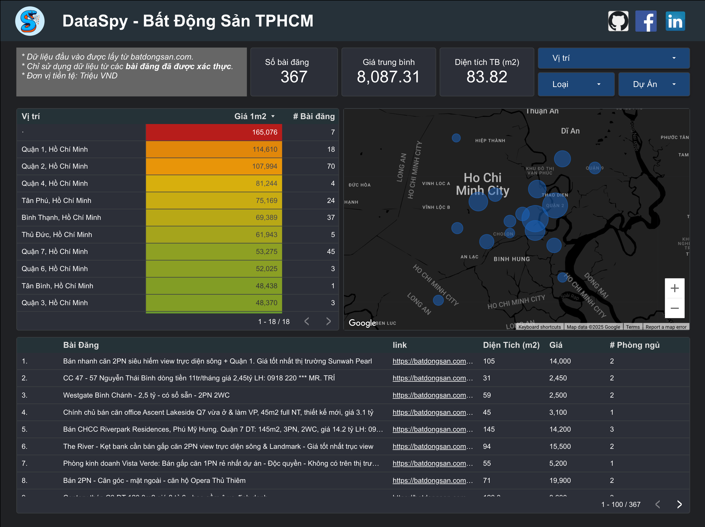
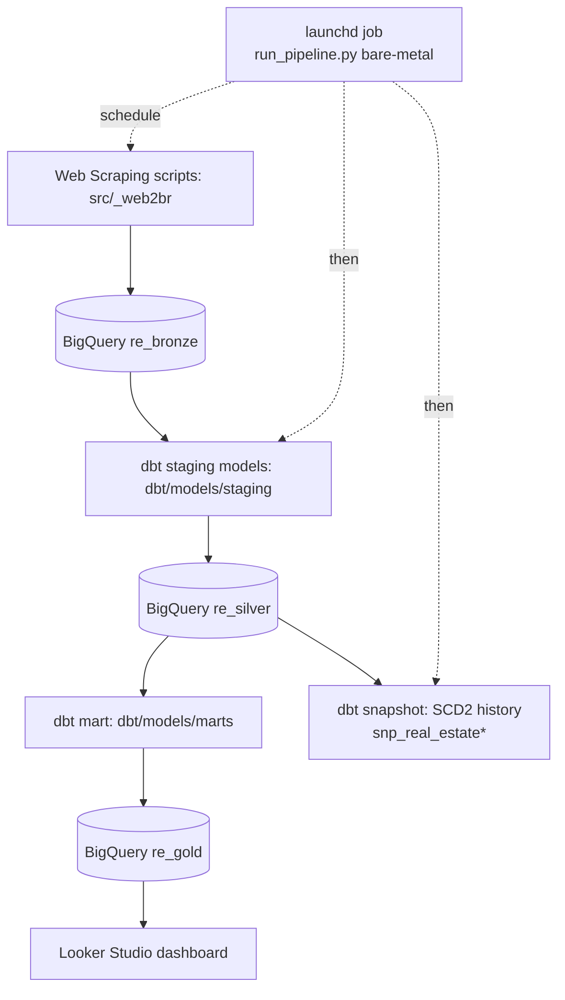

# Dữ liệu bất động sản

Dự án thu thập dữ liệu, chuẩn hóa dữ liệu để thực hiện phân tích về thị trường bất động sản tại Việt Nam với nguồn dữ liệu từ [batdongsan.com.vn](https://batdongsan.com.vn)

🔗 Trang giới thiệu dự án: **[dataspi.github.io/scrape-batdongsan-data](https://dataspi.github.io/scrape-batdongsan-data/)**

### Reports
*(Đông cứng từ 2026-05-20 — xem lưu ý bên dưới)*
- [Báo cáo giá bất động sản theo quận (cũ) tại HN & TPHCM](docs/reports/HCM-HN_districts.html)
- [Báo cáo giá bất động sản theo dự án tại HN & TPHCM](docs/reports/HCM-HN_prj.html)
- Bài viết: [Đi xem nhà cùng Data Analyst - P1](https://spyno.substack.com/p/i-xem-nha-cung-data-analyst-p1)
  - Tháng 9-2025

Báo cáo HTML tĩnh trên được build lần cuối (2026-05-20) qua pipeline Malloy/Postgres cũ, code đó
đã được xoá khỏi repo (còn trong git history) nên báo cáo không còn regenerate. Dashboard bên dưới
là nguồn phân tích sống.

### Dashboard 
*(Updated: 2026-02-16)*
- Dashboard: [Google Looker Studio](https://lookerstudio.google.com/reporting/9e21618f-97dc-4480-b101-cbda26b9b2a5) — nối trực tiếp BigQuery `re_gold.mart_real_estate` (khai báo qua dbt exposure, `dbt/models/marts/_exposures.yml`)

### Quy trình xử lý dữ liệu

Pipeline chạy định kỳ qua launchd (macOS) gọi thẳng `src/orchestrator/run_pipeline.py`
bare-metal — không có process nào chạy liên tục giữa các lần, vì batdongsan.com.vn chặn IP của
cloud/CI runner nên bước scrape bắt buộc chạy từ máy cá nhân. Airflow từng là scheduler (xem git
tag `airflow-final`) nhưng đã bị bỏ: tốn resource 24/7 cho một job 1 lần/tuần, và bước scrape cần
Chrome headed nên không chạy được trong container. GitHub Actions lo lint/dbt
parse/build Docker image; không chạy scrape thật. Chi tiết: [technical-guides.md](docs/technical-guides.md).

## Quickstart

- Quickstart: [docs/quickstart.md](docs/quickstart.md)
- Hướng dẫn kỹ thuật: [docs/technical-guides.md](docs/technical-guides.md)
