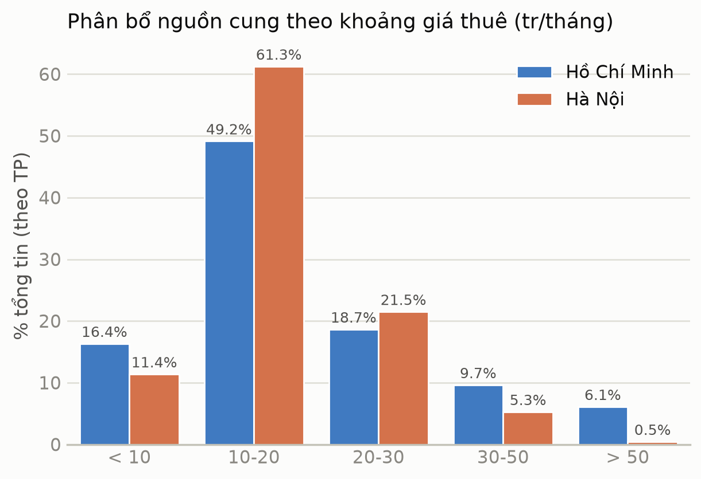
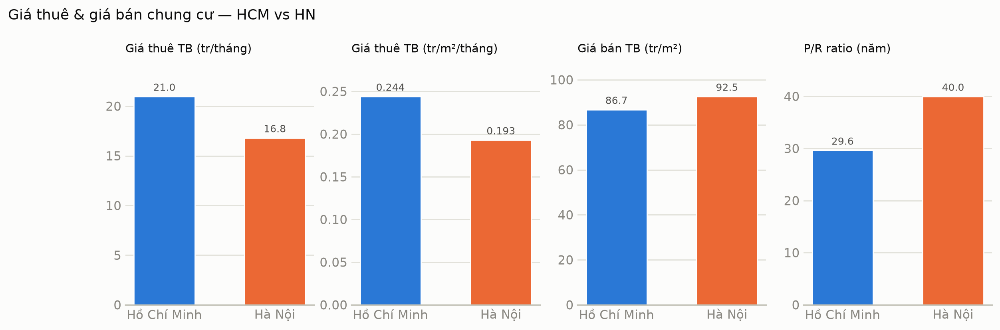
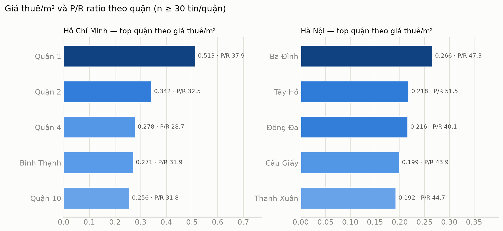
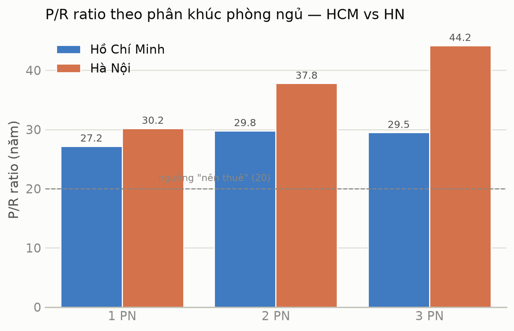
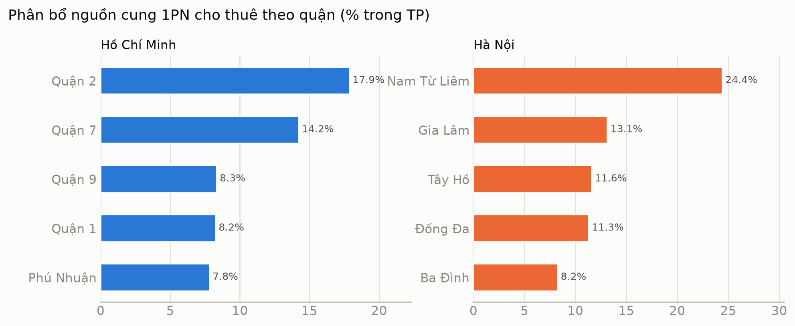
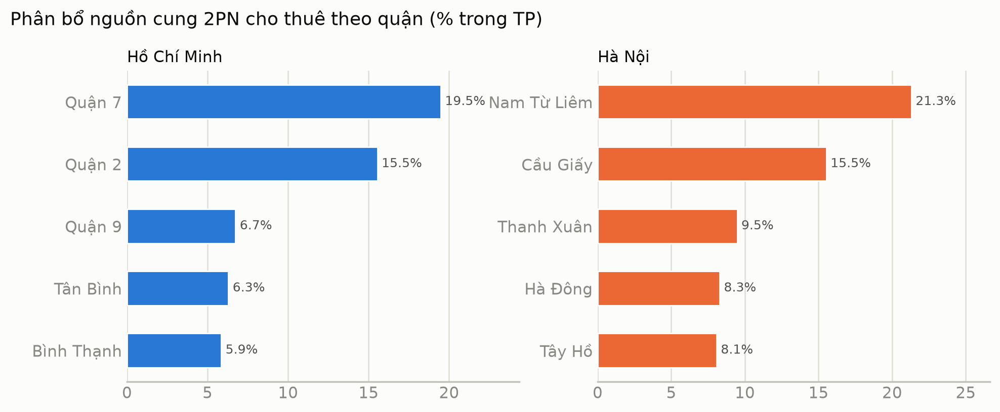
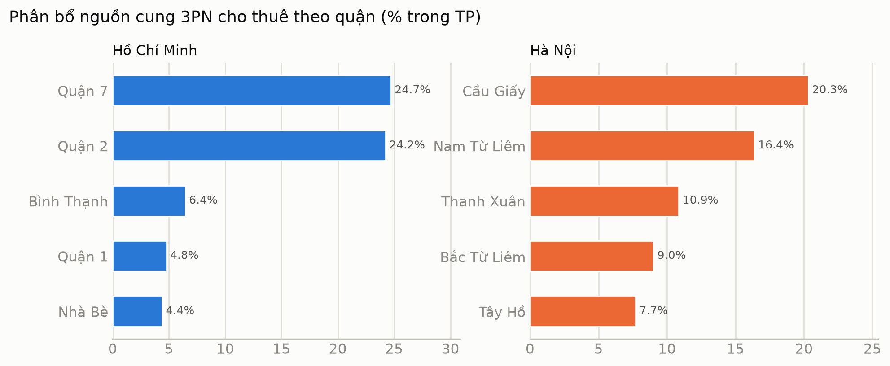

Bài thứ tư trong series, sau [chung cư update](chung-cu-2026-07-personal.md), [chung cư mini](chung-cu-mini-2026-07-personal.md) và [nhà đất](nha-dat-2026-07-personal.md). Lần này pipeline crawl xong loại hình `cho thuê căn hộ chung cư` — mảng dữ liệu mới, mới có đúng 1 ngày (13/7/2026).

Bài này viết theo đúng khuôn 3 bài trước — số liệu + bảng, không đi sâu lý thuyết (phần khung lý thuyết + nghiên cứu thuê-vs-mua quốc tế đã tách riêng ở bài khác). Mỗi bảng trong bài, ngoài giá thuê, đều kèm thêm 2 cột đối chiếu: **giá thuê tr/m²/tháng** và **tỷ suất P/R** (price-to-rent ratio = giá bán ÷ (giá thuê × 12 tháng), quy đổi từ giá bán tr/m² đã tính ở bài chung cư update).

# Khai báo kĩ thuật

- Nguồn dữ liệu: [https://batdongsan.com.vn/](https://batdongsan.com.vn/), loại hình `cho thuê căn hộ chung cư` — lần đầu tiên pipeline crawl loại này, chỉ có data của ngày **13/7/2026**. Tổng **11.093 tin** (HCM 7.674, HN 3.419), so với 53.713 tin chung cư bán đã crawl nhiều tuần — số thuê nên đọc như một lát cắt thăm dò, không chắc như bộ số bán.
- Đơn vị giá không giống nhau: giá bán là trọn gói (tỷ), giá thuê là theo tháng (triệu/tháng) — hai con số này không so trực tiếp được, nên mọi bảng trong bài quy đổi cả hai về `tr/m²` để so sánh (giá bán tr/m², giá thuê tr/m²/tháng), cộng thêm P/R ratio.
- Bộ lọc outlier: bộ ngưỡng giá/m² cho data bán (5-1.000 tr/m²) chưa có bản tương ứng cho data thuê vì mới crawl lần đầu. Đã phát hiện 1 tin lỗi parse diện tích thành 76.000.000 m² (căn 2PN Masteri Lumiere) — lọc thô diện tích 15-200m² và giá thuê 1-200 tr/tháng trước khi tính, số trong bài là số đã lọc (11.093 → 10.676 tin sau lọc, mất 3.8%).
- Kỹ thuật & data viz: xem [Khai báo kĩ thuật ở bài chung cư update](chung-cu-2026-07-personal.md#khai-báo-kĩ-thuật) — không lặp lại ở đây. Dashboard Looker Studio: mart dữ liệu thuê mới thêm, **chưa có trang riêng** để lọc/so thuê — phần này để sau, xem note ở mục "Hướng dẫn sử dụng dashboard".

# Tổng quan

## Nguồn cung

**Nguồn cung thuê dồn mạnh vào khoảng 10-20 tr/tháng ở cả hai thành phố, nhưng HCM có đuôi giá cao dày hơn hẳn HN.**

| Khoảng giá thuê (tr/tháng) | HCM (số tin / %) | HN (số tin / %) |
|---|---|---|
| < 10 | 1.229 / **16.4%** | 361 / **11.4%** |
| 10-20 | 3.694 / **49.2%** | 1.938 / **61.3%** |
| 20-30 | 1.403 / **18.7%** | 681 / **21.5%** |
| 30-50 | 726 / **9.7%** | 168 / **5.3%** |
| > 50 | 461 / **6.1%** | 15 / **0.5%** |

- HN gần như dồn hết vào khoảng 10-20 tr (61.3%), tin trên 30 tr chỉ chiếm 5.8% tổng cung.
- HCM dàn trải hơn hẳn — tin trên 30 tr chiếm tới **15.8%** (so với 5.8% ở HN), phản ánh phân khúc cao cấp (Q1, Q2...) dày hơn.

## Giá — HCM vs HN

**HCM thuê đắt hơn HN tính theo m², nhưng bán lại rẻ hơn — nên P/R ratio HCM thấp hơn hẳn HN.**

| TP | Giá thuê TB (tr/tháng) | Giá thuê TB (tr/m²/tháng) | Giá bán TB (tr/m²) | P/R ratio |
|---|---|---|---|---|
| HCM | 20.97 | 0.244 | 86.73 | ≈ **29.6 năm** |
| HN | 16.80 | 0.193 | 92.55 | ≈ **40.0 năm** |

- Giá thuê tr/m² HCM cao hơn HN **26%**, nhưng giá bán tr/m² HCM lại thấp hơn HN **6.3%** — hai chiều ngược nhau này kéo P/R ratio giãn ra rất xa: HCM 29.6 năm so với HN 40.0 năm.
- Xét thuần kinh tế theo framework P/R, mua nhà ở HCM "đỡ bất lợi" hơn Hà Nội rõ rệt so với thuê — dù cả hai đều vượt xa ngưỡng "nên thuê" (20 năm).

## Phân hóa theo vị trí

**Quận càng đắt để thuê không nhất thiết là quận có P/R ratio cao nhất — nhưng ở top đầu hai thành phố thì đúng vậy.**

Top 5 quận theo giá thuê/m² mỗi thành phố (tất cả đều có tối thiểu 30 tin để đủ tin cậy):

| TP | Quận | Giá thuê TB (tr/m²/tháng) | Giá bán TB (tr/m²) | P/R ratio |
|---|---|---|---|---|
| HCM | Quận 1 | 0.513 | 233.21 | ≈ 37.9 năm |
| HCM | Quận 2 | 0.342 | 133.18 | ≈ 32.5 năm |
| HCM | Quận 4 | 0.278 | 95.86 | ≈ 28.7 năm |
| HCM | Bình Thạnh | 0.271 | 103.86 | ≈ 31.9 năm |
| HCM | Quận 10 | 0.256 | 97.58 | ≈ 31.8 năm |
| HN | Ba Đình | 0.266 | 151.10 | ≈ 47.3 năm |
| HN | Tây Hồ | 0.218 | 134.65 | ≈ 51.5 năm |
| HN | Đống Đa | 0.216 | 103.84 | ≈ 40.1 năm |
| HN | Cầu Giấy | 0.199 | 104.80 | ≈ 43.9 năm |
| HN | Nam Từ Liêm | 0.192 | 89.72 | ≈ 38.9 năm |

- Quận 1 (HCM) và Ba Đình (HN) là hai quận thuê đắt nhất mỗi thành phố — đúng như kỳ vọng, đây cũng là hai quận bán đắt nhất.
- Nhưng **P/R ratio cao nhất không rơi vào quận đắt nhất**: ở HN, Tây Hồ (0.218 tr/m²/tháng, hạng 2 về giá thuê) mới có P/R cao nhất (51.5 năm), vượt cả Ba Đình. Ở phía rẻ, Gia Lâm — quận thuê rẻ nhất trong nhóm đủ mẫu (0.170 tr/m²/tháng) — lại có P/R chỉ 33.8 năm, thấp hơn hẳn Tây Hồ. Tức là các quận lõi đắt đỏ vừa tốn tiền hơn để mua, vừa kém lợi hơn so với thuê — bất lợi kép, không phải chỉ một chiều.

# Phương pháp phân tích

Giữ nguyên 3 nhóm khách thuê điển hình từ bài chung cư, đổi từ ngân sách *mua* sang ngân sách *thuê hàng tháng*. Mốc ngân sách dưới đây là ước lượng chủ quan của mình (không phải khảo sát), chọn sao cho vẫn tạo được khoảng chia % có ý nghĩa giữa hai thành phố — không phải con số "chuẩn" nào cả:

1. Người độc thân, hoặc vợ chồng chưa/không có con → thường thuê căn 1PN.
   - Ngân sách thuê giả định: **10 tr/tháng**.
2. Gia đình nhỏ, vợ chồng và 1-2 con → thường thuê căn 2PN.
   - Ngân sách thuê giả định: **15 tr/tháng**.
3. Gia đình 3 thế hệ cùng sinh sống → thường thuê căn 3PN.
   - Ngân sách thuê giả định: **20 tr/tháng**.

# 1 phòng ngủ

> Khách hàng điển hình:
> - Người độc thân, hoặc vợ chồng chưa/không có con
> - Ngân sách thuê: 10 tr/tháng

| TP | Giá thuê TB (tr/tháng) | Giá thuê TB (tr/m²/tháng) | Giá bán TB (tr/m²) | P/R ratio | % dưới 10 tr/tháng |
|---|---|---|---|---|---|
| HCM | 13.57 | 0.278 | 90.66 | ≈ 27.2 năm | 330/1.154 ≈ **28.6%** |
| HN | 11.68 | 0.245 | 88.87 | ≈ 30.2 năm | 123/328 ≈ **37.5%** |

- HN dễ kiếm căn 1PN trong ngân sách 10 tr hơn HCM (37.5% so với 28.6%), dù giá thuê TB HN thấp hơn HCM không nhiều (11.68 so với 13.57 tr/tháng).
- P/R ratio 1PN vẫn thấp nhất trong 3 phân khúc ở cả hai thành phố (27.2 và 30.2 năm) — tín hiệu tương tự phát hiện ở bài thuê-vs-mua: căn nhỏ có P/R "đỡ tệ" hơn căn to.

## Phân bổ

**Nguồn cung 1PN dồn về đúng các quận đô thị mới đã thấy ở bài chung cư (Q2/Q7 HCM, Nam Từ Liêm HN) — nhưng thứ tự giá thuê/m² lại không theo thứ tự nguồn cung.**

| TP | Quận | % nguồn cung | Giá thuê TB (tr/m²/tháng) |
|---|---|---|---|
| HCM | Quận 2 | 206/1.154 ≈ **17.9%** | 0.328 |
| HCM | Quận 7 | 164/1.154 ≈ **14.2%** | 0.260 |
| HCM | Quận 9 | 96/1.154 ≈ **8.3%** | 0.141 |
| HCM | Quận 1 | 95/1.154 ≈ **8.2%** | 0.477 |
| HN | Nam Từ Liêm | 80/328 ≈ **24.4%** | 0.247 |
| HN | Gia Lâm | 43/328 ≈ **13.1%** | 0.180 |
| HN | Tây Hồ | 38/328 ≈ **11.6%** | 0.251 |

> Quận 1 chỉ chiếm 8.2% nguồn cung 1PN ở HCM nhưng giá thuê/m² (0.477) gần gấp rưỡi Quận 2 — quận nhiều tin nhất không phải quận đắt nhất, đúng pattern "đổi ngôi" đã thấy ở các bài chung cư/nhà đất trước.

# 2 phòng ngủ

> Khách hàng điển hình:
> - Gia đình nhỏ, vợ chồng và 1-2 con
> - Ngân sách thuê: 15 tr/tháng

| TP | Giá thuê TB (tr/tháng) | Giá thuê TB (tr/m²/tháng) | Giá bán TB (tr/m²) | P/R ratio | % dưới 15 tr/tháng |
|---|---|---|---|---|---|
| HCM | 17.17 | 0.219 | 78.41 | ≈ 29.8 năm | 1.939/4.065 ≈ **47.7%** |
| HN | 14.66 | 0.190 | 86.11 | ≈ 37.8 năm | 791/1.436 ≈ **55.1%** |

- HN vẫn dễ kiếm nhà trong ngân sách hơn HCM (55.1% so với 47.7%) — cùng chiều với phân khúc 1PN.
- Nhưng P/R ratio HN (37.8 năm) gần gấp rưỡi HCM (29.8 năm): thuê ở HN "vừa túi tiền" hơn không có nghĩa mua ở HN kinh tế hơn — ngược lại.

## Phân bổ

| TP | Quận | % nguồn cung | Giá thuê TB (tr/m²/tháng) |
|---|---|---|---|
| HCM | Quận 7 | 792/4.065 ≈ **19.5%** | 0.220 |
| HCM | Quận 2 | 632/4.065 ≈ **15.5%** | 0.310 |
| HCM | Quận 9 | 274/4.065 ≈ **6.7%** | 0.140 |
| HN | Nam Từ Liêm | 306/1.436 ≈ **21.3%** | 0.193 |
| HN | Cầu Giấy | 223/1.436 ≈ **15.5%** | 0.206 |
| HN | Thanh Xuân | 136/1.436 ≈ **9.5%** | 0.190 |

> Cùng pattern với 1PN: Quận 2 (HCM) đứng thứ 2 về nguồn cung nhưng giá thuê/m² (0.310) cao nhất nhóm — cao hơn cả Quận 7 (quận nhiều tin nhất, 0.220).

# 3 phòng ngủ

> Khách hàng điển hình:
> - Gia đình 3 thế hệ cùng sinh sống
> - Ngân sách thuê: 20 tr/tháng

| TP | Giá thuê TB (tr/tháng) | Giá thuê TB (tr/m²/tháng) | Giá bán TB (tr/m²) | P/R ratio | % dưới 20 tr/tháng |
|---|---|---|---|---|---|
| HCM | 31.62 | 0.267 | 94.38 | ≈ 29.5 năm | 681/1.845 ≈ **36.9%** |
| HN | 20.43 | 0.181 | 95.92 | ≈ 44.2 năm | 592/1.142 ≈ **51.8%** |

- Phân khúc 3PN có khoảng cách giá thuê TB lớn nhất giữa hai thành phố: HCM 31.62 tr/tháng so với HN chỉ 20.43 tr/tháng — chênh **55%**.
- P/R ratio 3PN cũng giãn xa nhất trong 3 phân khúc: HN 44.2 năm so với HCM 29.5 năm — đúng pattern đã thấy ở bài thuê-vs-mua, càng phòng ngủ to thì P/R ở HN càng phình ra.

## Phân bổ

| TP | Quận | % nguồn cung | Giá thuê TB (tr/m²/tháng) |
|---|---|---|---|
| HCM | Quận 7 | 456/1.845 ≈ **24.7%** | 0.247 |
| HCM | Quận 2 | 447/1.845 ≈ **24.2%** | 0.374 |
| HCM | Bình Thạnh | 119/1.845 ≈ **6.4%** | 0.282 |
| HCM | Quận 1 | 88/1.845 ≈ **4.8%** | 0.607 |
| HN | Cầu Giấy | 232/1.142 ≈ **20.3%** | 0.187 |
| HN | Nam Từ Liêm | 187/1.142 ≈ **16.4%** | 0.165 |
| HN | Thanh Xuân | 124/1.142 ≈ **10.9%** | 0.183 |

> Quận 7 và Quận 2 gộp lại chiếm gần một nửa (48.9%) nguồn cung 3PN cho thuê ở HCM — đúng hai quận cũng dẫn đầu nguồn cung 3PN *bán* ở bài nhà đất/chung cư. Quận 1 chỉ chiếm 4.8% nguồn cung nhưng giá thuê/m² (0.607) cao vượt trội — gần gấp đôi Bình Thạnh, quận đắt thứ nhì trong nhóm.

# Hướng dẫn sử dụng dashboard

Mart dữ liệu thuê mới thêm vào, **dashboard Looker Studio chưa có trang riêng để lọc/so thuê vs bán** — phần này sẽ cập nhật ở bài sau khi trang mới xong. Trong lúc chờ, các bảng trong bài này là cách duy nhất để tra cứu số liệu thuê theo quận/phân khúc.

# Kết

So với bộ số bán đã quen ở 2 bài trước, bức tranh thuê cho thấy rõ nghịch lý: **Hà Nội "dễ thở" hơn HCM nếu chỉ nhìn giá thuê tuyệt đối và tỷ lệ vừa túi tiền, nhưng lại kém lợi hơn hẳn HCM nếu tính đến P/R ratio** — vì giá bán Hà Nội đắt hơn không tương xứng với mức giá thuê rẻ hơn. Quận lõi (Quận 1 HCM, Tây Hồ/Ba Đình HN) tiếp tục là nơi vừa đắt nhất vừa có P/R ratio cao nhất — bất lợi kép cho người muốn mua.

Vẫn câu hỏi cũ: anh em gom được mấy mét đất thành phố rồi nào, hay đang tính đường thuê tiếp?

> P/S: Bài tiếp theo trong series, dự kiến quay lại đào sâu khung lý thuyết + nghiên cứu quốc tế về hành vi thuê/mua — bản nháp đã có, đang chờ hoàn thiện. Hẹn gặp lại, và như mọi lần, anh em tin tôi đi =)))
