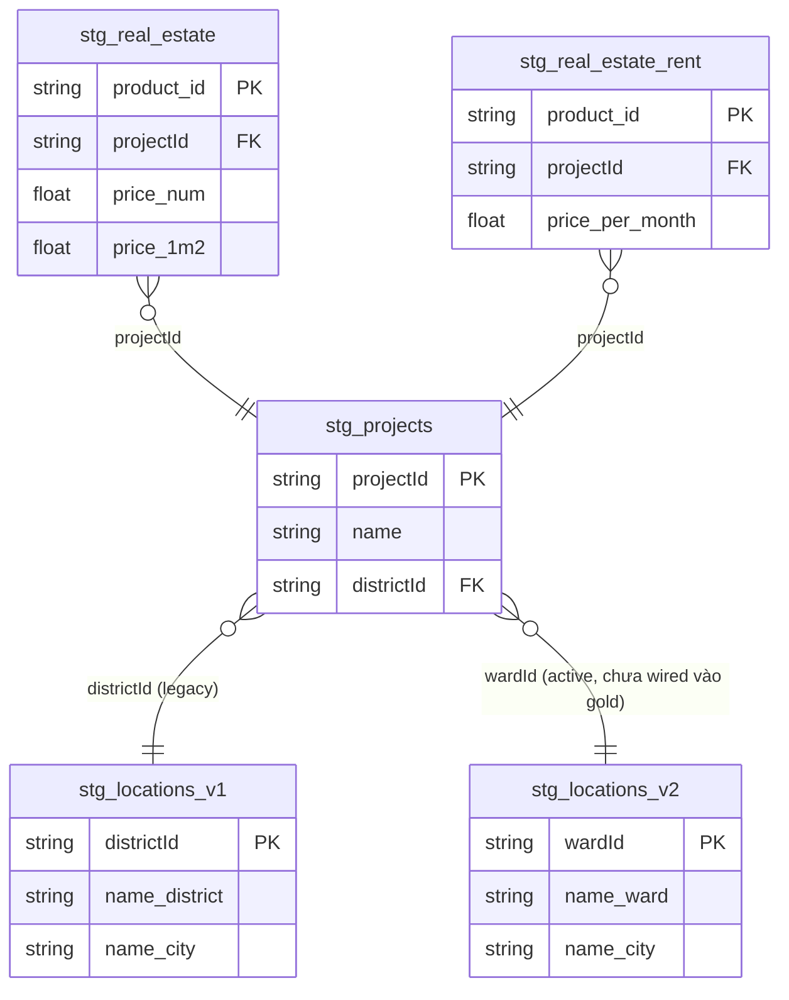
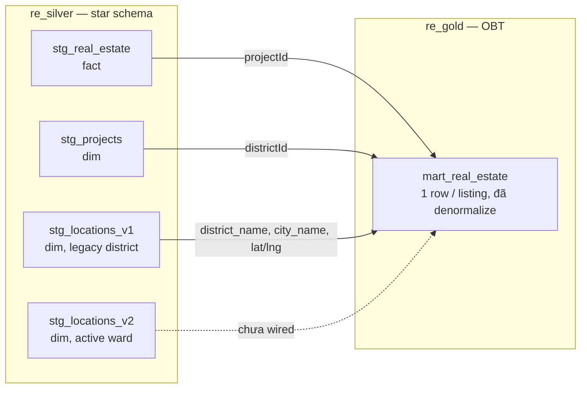

# Data Modeling & Architecture

Tài liệu ngắn để dùng làm script thuyết trình về cách domain bất động sản được model qua 3
layer BigQuery (`re_bronze` → `re_silver` → `re_gold`). Chi tiết vận hành xem
[technical-guides.md](technical-guides.md); tài liệu này chỉ nói về **shape của model**, không
nói về orchestration.

## 1. Silver — star schema (logical model)

`re_silver` là nơi domain thực tế được model lại: `Listing` là fact, `Project` và `Location`
là dimension xoay quanh.

**Điểm nói khi thuyết trình:**
- 2 fact riêng (`stg_real_estate` bán, `stg_real_estate_rent` thuê) — giá thuê là giá/tháng,
  không cùng thang với giá bán nên không gộp chung 1 fact.
- `Location` có **2 version tường minh** (v1 = địa giới cũ, v2 = sau sáp nhập hành chính) thay
  vì SCD tổng quát (`valid_from`/`valid_to`) — vì biết trước domain chỉ đổi đúng 1 lần, build
  engine SCD generic là over-engineering.
- Chi tiết thực tế hay: listing **không join thẳng** vào `Location` bằng districtId/wardId của
  chính nó — join **qua `Project`** (`projectId` → `Project.districtId`), vì FK district/ward
  trực tiếp trên listing thiếu dữ liệu nhiều hơn FK qua project.

## 2. Gold — One Big Table (physical/serving model)

`re_gold` **không model lại domain** — nó chỉ pre-join star schema ở silver thành 1 bảng phẳng
cho đúng nhu cầu của BI tool đang dùng.

**Vì sao OBT, không phải star tiếp ở gold:** Looker Studio (free tier) join kém — nếu đưa
fact + dimension riêng vào BI, vẫn phải tự join ở đó, chỉ đổi *nơi* join, không giảm việc join.
Nên pre-join sẵn trong dbt (có test), gold chỉ là **physicalize lại model đã có ở silver**,
không phải model mới.

## 3. Trade-off của OBT ở serving layer

| | Star (silver) | OBT (gold) |
|---|---|---|
| Update 1 attribute (VD: đổi tên project) | Update 1 row dimension | Rebuild lại mart |
| Reuse dimension cho fact mới | `dim_location` dùng lại được ngay | Phải build OBT riêng, lặp lại join logic |

Chấp nhận được ở scale hiện tại (data nhỏ, pipeline chạy weekly) — nhưng là cost thực sự, không
phải free lunch.

## 4. Khi nào cần revisit

Quay lại re-project silver thành star schema thật ở gold (thay vì tiếp tục mở rộng OBT) khi:
volume tăng mạnh, có thêm BI tool/consumer khác ngoài Looker Studio, thêm fact mới
(`price_history`, ...), `Location` đổi version lần 3, hoặc cần phân tích lịch sử thay vì
current-state.
