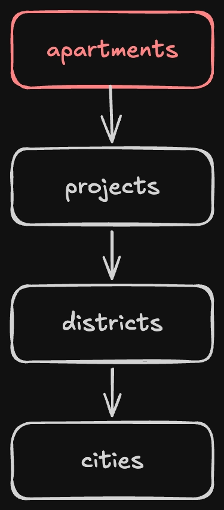
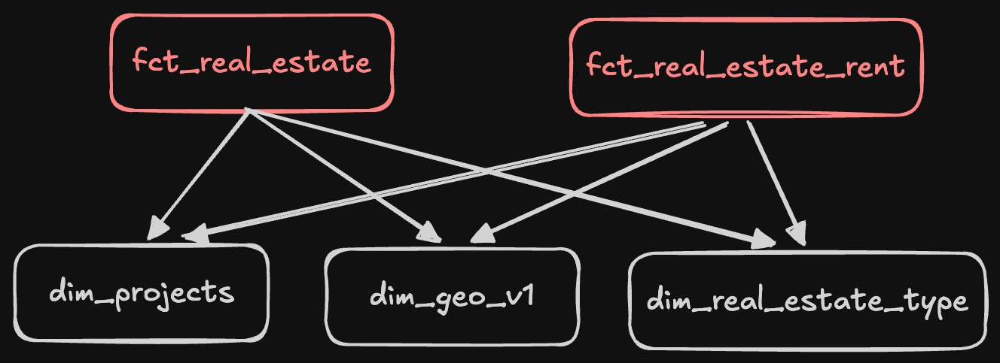
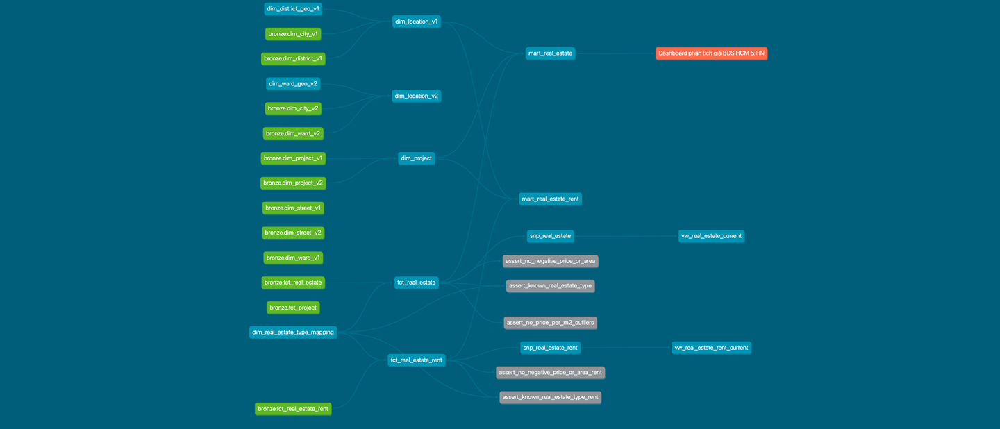
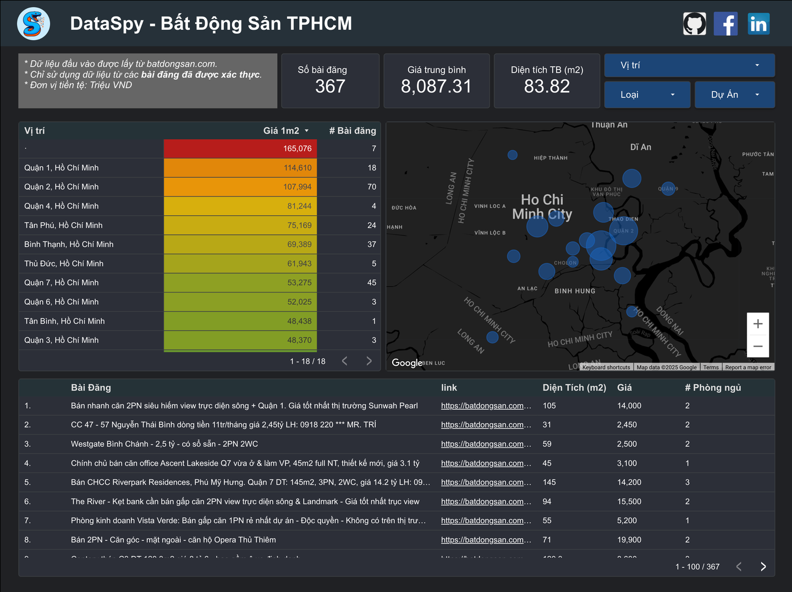

# Interview Prep — scrape-batdongsan-data

Bám theo `Infinite Lambda Interview Prep.excalidraw`. Mỗi mục: **câu chốt** + vài bullet để nói.

## 0. Overview

```text
batdongsan.com ──python scraper──▶ BigQuery ──dbt──▶ Looker Studio
```

+ Dự án 1 người: scrape BĐS HCM + HN, chạy hằng tuần → BigQuery (`re_bronze` → `re_silver` → `re_gold`) → Looker Studio.
+ Ràng buộc gốc: site chặn IP cloud → scrape phải chạy từ IP nhà (laptop, launchd).
+ **Câu chốt:** *"Dự án nhỏ — điều đáng nói là tôi chọn dừng ở đâu, và sẽ làm khác gì nếu đây là hệ thống của khách hàng."*

## 1. Data Modeling



+ **v1 (chỉ chung cư):** `apartments → projects → districts → cities`. Join location qua `projectId`, vì:
    + Năm 2025 sáp nhập địa giới: HN hiển thị theo địa giới cũ (`districtId`), HCM theo địa giới mới (`wardId`), không map 1:1.
    + `projectId` không đổi qua đợt sáp nhập → dùng làm cầu nối.
+ **v2 (thêm nhà đất):** nhà đất không có `projectId` → sửa ở **tầng scrape**: cào theo từng `districtId` cũ, site trả về đúng version địa giới mình cần.



+ **Star schema ở silver:** `fct_real_estate`, `fct_real_estate_rent` × `dim_project`, `dim_geo_v1`, `dim_real_estate_type`.
+ **Gold = 2 OBT** (bán, thuê), vì Looker Studio free join rất yếu.
+ **Naming:** `fct_`/`dim_` ở cả bronze lẫn silver. Rename 20 bảng production bằng `ALTER TABLE ... RENAME TO`, verify bằng row count khớp + `dbt snapshot` báo 0 rows changed (reconciliation).

## 2. Data Transformation

| Transformation layer | Làm gì | Medallion |
|---|---|---|
| python | raw HTML → fields (BeautifulSoup + regex `pageTrackingData`) | **bronze** |
| intermediate | chuẩn hoá kiểu, flag outlier, dedup | **silver** (+ **snapshot**) |
| mart | join thành OBT, binning, loại outlier | **gold** |

+ **Bug dedup 294 listing:** script pandas cũ dedup theo 10 ký tự cuối của link, nên dính query string `?c=d1` → port sang dbt thì phát hiện ra. Sửa bằng `row_number() over (partition by product_id order by scraped_at desc)`.
+ **Incremental:** `fct_*` chuyển từ `table` sang `incremental`, watermark theo `date_scraped`. Đổi materialization không ảnh hưởng downstream, vì `ref()` che physical layer.
+ **SCD2 snapshot:**

```sql

{{ config(
    target_schema='re_silver', unique_key='product_id', strategy='check',
    check_cols=['price_num','price_1m2','is_price_outlier','area_num','bedrooms',
                'toilets','real_estate_type','expired','vipType','productType'],
    hard_deletes='new_record'
) }}
select * from {{ ref('fct_real_estate') }}

```

    + Dùng `check` thay vì `timestamp` vì `scraped_at` là lúc *tôi cào*, không phải lúc tin *đổi*.
    + `check_cols` liệt kê tường minh: bỏ `title` (noisy) và `districtId` (gần như tĩnh).
    + `hard_deletes='new_record'`: tin bị gỡ → thêm 1 dòng mới `dbt_is_deleted`, đọc qua view `vw_real_estate_current`.

## 3. Data Quality



+ **Silver:** `not_null` + `unique` trên khoá.
+ **Gold:** data contract (`contract.enforced`) khoá tên cột + data type → nếu schema lệch thì `dbt run` fail luôn, không đẩy xuống Looker.
+ **5 custom singular test (silver):**
    + `assert_known_real_estate_type(_rent)`
    + `assert_no_negative_price_or_area(_rent)`
    + `assert_no_price_per_m2_outliers`
+ Thêm: source `freshness` (warn 10 ngày / error 21 ngày), FK `projectId` để `severity: warn` (~5% thiếu là hành vi thật của nguồn), hash `phone` ngay tại silver.
+ **Tự nêu gap:** chưa có alert khi test fail, freshness đã khai báo nhưng chưa nằm trong STEPS.

## 4. Data Insights



Blog: <https://spyno.substack.com/p/i-xem-chung-cu-cung-tho-so-p2>

| Metric | Join | Aggregation / Filter | Business impact |
|---|---|---|---|
| Giá/m² theo quận | `fct_real_estate` ⋈ `dim_project` ⋈ `dim_location_v1` | bin `price_1m2`, loại `is_price_outlier` (5–1.000 tr/m²) | So giá giữa các quận mà không bị lỗi nhập đơn vị kéo lệch |
| Phân khúc giá bán | (như trên) | 6 bucket theo `price_num` (tỷ) | Lọc theo ngân sách trên dashboard |
| Giá thuê/tháng theo quận | `fct_real_estate_rent` ⋈ `dim_project` ⋈ `dim_location_v1` | bin giá thuê, **chưa** có outlier filter | So chi phí thuê; gap được công khai, không giấu |
| **P/R ratio HCM vs HN** | 2 fact riêng + conformed dimension | `avg(price_1m2)` / giá thuê quy về tr/m², theo `city_name` | HCM ~29.6 năm, HN ~40 năm → giá bán ở HN xa giá trị sử dụng hơn |

+ Metric P/R chỉ tính được nhờ conformed dimension. Hiện nó nằm ở blog, chưa lên dashboard. Hướng vá: làm `mart_price_to_rent`.

## 5. DataOps

| Practice | Evidence | Why it matters |
|---|---|---|
| 1 branch/PR mỗi stage | `init-claude-md → stage2-docker → stage2-airflow → stage2-cicd → stage2-docs`, merge commit thật `af4b83a` | Giao dần từng phần thật, lịch sử không dựng lại cho đẹp |
| CI fast feedback, gated push | `ruff` + build Docker mọi PR; chỉ push GHCR khi merge `main` | PR nào cũng được check rẻ; chỉ code đã merge mới ra artifact |
| dbt CI theo path | `dbt-ci.yml` filter `dbt/**`, `dbt compile --target ci`, SA từ secret | PR không đụng dbt thì không tốn BigQuery; credentials không nằm trên disk |
| Release gắn tag | `:latest` + `:${{ github.sha }}` | Rollback = đổi tag, không cần rebuild |
| **Đảo ngược Airflow** | Airflow self-host tốn ~1–1.5GB RAM 24/7 cho 1 job/tuần → chuyển sang launchd bare-metal | Câu chuyện "consultant" nhất: đo chi phí thật rồi đổi. DAG vẫn giữ trong repo |

+ Bỏ Airflow thì mất: retry, backfill, lịch sử run → biết tự bù bằng cách nào (backoff quanh `run_step()`, tham số ngày, bảng log run).

## 6. What if... data 10x?

**Giả định:** nguồn là API nội bộ (không lo IP, rate limit), data gấp 10 lần: ~470k rows/run, ~235MB/run.

**Câu chốt:** *10x của small data vẫn là small data → đổi pattern, không đổi tool.*

### 6.1 Hạ tầng & giá

Bỏ laptop + launchd → 1 server Linux chạy Docker image có sẵn trên GHCR.

| Thành phần | Chọn | Giá/tháng |
|---|---|---|
| Server | VPS 2vCPU/4GB (Hetzner, DigitalOcean) | ~$5–12 |
| Object storage | GCS (hoặc MinIO tự host → $0) | < $1 |
| BigQuery | storage + compute (mục 6.4) | ~$0–10 |
| Alert / health check | Telegram bot + healthchecks.io | $0 |
| **Tổng** | | **~$5–20** |

+ Thay thế nếu không muốn giữ server: Cloud Run Jobs + Cloud Scheduler (~$0–5, tính theo giây chạy).

### 6.2 Ops: log & alert

+ **Lịch:** systemd timer thay launchd (`Persistent=true` → chạy bù nếu lỡ lịch), `flock` chặn 2 run đè nhau.
+ **Retry:** backoff quanh từng step trong `run_pipeline.py`.
+ **Log:** journald + 1 file log theo `run_id`; mỗi step ghi 1 dòng vào bảng BQ `pipeline_runs` (`run_id, step, start, end, status, rows`) → có lịch sử run, cắm được vào Looker Studio.
+ **Alert 2 lớp:**
    + **Telegram bot** khi fail (`OnFailure=` của systemd): tên step, exit code, 30 dòng log cuối.
    + **healthchecks.io** (dead man's switch): chạy xong thì ping, quá hạn không ping → alert. Bắt được cả lúc server chết.
+ Warning (test `warn`, freshness) → gom thành digest email hằng tuần, không push → tránh alert fatigue.

### 6.3 Không giữ hết data trong RAM → Parquet

```text
API ──▶ Python (flush mỗi N trang) ──▶ Parquet ──▶ object storage ──load job──▶ BigQuery re_bronze
```

+ Scraper ghi Parquet theo từng chunk thay vì dồn 1 DataFrame lớn → RAM phẳng, không phụ thuộc volume.
+ File partition theo ngày: `raw/fct_real_estate/date=2026-09-25/part-0001.parquet`.
+ Object storage = lớp raw bất biến → **re-load/backfill** BigQuery mà không phải gọi lại API.
+ Load idempotent: `WRITE_TRUNCATE` vào đúng partition (`fct_real_estate$20260925`) → chạy lại không nhân đôi.

| | GCS (cloud) | MinIO (open source) |
|---|---|---|
| Là gì | Object storage của GCP | S3-compatible, tự host bằng Docker trên VPS |
| Giá | ~$0.02/GB/tháng → < $1 | $0, tốn disk VPS |
| Nối BigQuery | Load thẳng từ `gs://` (free), hoặc external table | Không load thẳng được → Python đọc file rồi load |
| Vận hành | Không phải lo | Tự backup, tự lo đầy disk |
| Khi nào chọn | **Đã ở GCP → chọn cái này** | Khách on-prem / muốn cloud-agnostic / không được đẩy data lên cloud |

### 6.4 Tối ưu giá BigQuery

BigQuery tính tiền **storage + bytes query quét**, không tính data vào/ra: load job free, kết quả query free.

| Việc | Áp dụng |
|---|---|
| **Partition** | `partition_by date_scraped` cho bronze + `fct_*` → query/test chỉ quét ngày cần |
| **Cluster** | `cluster_by product_id` (MERGE nhanh, không quét hết bảng), `cityCode`/`districtId` (filter dashboard) |
| **Ép filter** | `require_partition_filter=true` ở bronze → không ai lỡ tay quét full |
| **Test nhẹ** | config `where: "date_scraped >= current_date - 7"` cho test nặng |
| **Không `select *`** | mart chỉ lấy cột dashboard dùng — BQ tính theo cột |
| **Rào chắn** | `maximum_bytes_billed` trong profile dbt + budget alert GCP |
| **Looker Studio** | bật data freshness cache → mỗi lượt xem không = 1 query mới |
| **Đo** | `INFORMATION_SCHEMA.JOBS` → `total_bytes_billed` trước/sau |

**Verdict:** *Scale bằng config & infra, không phải remodel.*
